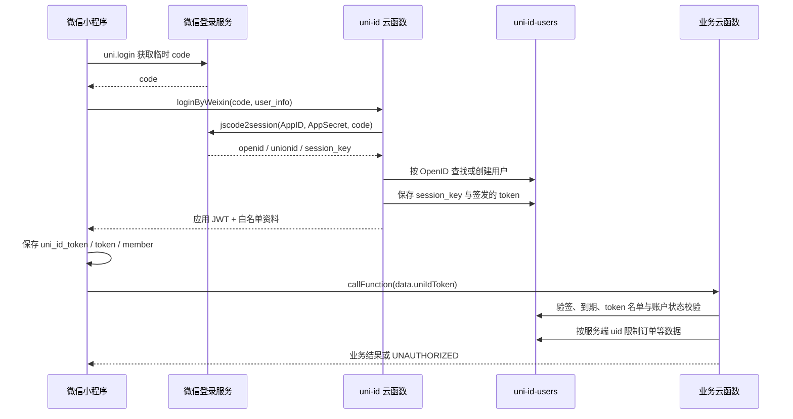

# REMAI 认证说明（按实际代码，2026-10-14）

这里说明本地代码的现状。尚未验证云端部署和实际微信账号。旧工程报告中的密码算法和支付配置已过时。

## 用户认证组件与请求过程

- `小程序前端/pages/login/login.vue`：真实微信入口调用 uni.login，再请求会员资料并调用 api.loginByWeixin。H5 的开发资料预览只在 dev 显示，其伪 token 不能通过后端 JWT 校验，不能当作真实账户。
- `小程序前端/api/index.js`：序列化请求，把 userInfo 转 user_info，把 token 放 event.uniIdToken；云函数没有依赖自定义 header 作为唯一 token 通道。成功数据 snake_case→camelCase；UNAUTHORIZED/401/令牌无效等触发本地注销。
- `uniCloud-aliyun/cloudfunctions/uni-id/index.js`：WX_APPID/WX_APPSECRET 优先环境变量，兼容 uni-config-center 的微信 oauth 配置；只服务端调用 jscode2session。现在同时接受 userInfo/user_info。客户端昵称、头像不参与身份校验，真正身份来自微信返回的 openid。
- `cloudfunctions/common/uni-id-common/index.js`：createToken 生成 HS256 JWT，包含 uid、role、permission、iat、exp，并写用户 token 名单。此项目对 checkToken 做了最小修补，确保每次校验读取账户状态和 token 名单，解决原实现在未临近到期时可能绕过即时撤销/封禁的问题。真实模块执行测试已覆盖有效、撤销、封禁。
- `cloudfunctions/common/uni-config-center/index.js`：针对 uni-id 插件叠加环境变量签名配置，UNI_ID_TOKEN_SECRET 必须至少 32 字符。三套可能部署的配置副本已清空内置 tokenSecret/passwordSecret，并应用同样补丁。未配置会拒绝认证；这不是自动部署或自动轮换。
- `小程序前端/store/index.js`：token 保存于 uni_id_token 和历史 token，member 独立保存，应用启动恢复。收到认证过期事件时清 Vuex/缓存/订单/地址。注销仍是本地行为，没有调用服务器撤销端点。
- member/order/pay/cart/address/card/coupon/points 在服务端从校验结果读取 uid，再限制自己的记录。用户传入 member_id 不能替代验证身份。部分公开读接口无需登录；公开菜单和 banner 正常保留。

应用 token 与微信 code/session_key 不同：code 用来一次性换取微信会话；session_key 留服务器数据库；应用 JWT 用于本项目后续请求。OpenID 可作为服务端支付 payer，但不是密码。JWT 是签名而非加密，payload 不应存密钥。

目前业务函数使用 autoRefresh:false，登录令牌按云端 tokenExpiresIn 到期后重新微信登录；未建立完整刷新协议，不能承诺无缝续期。配置副本的期限仍须在部署前统一审查。

## 管理员认证

`管理后台/src/pages/login/index.vue` → `src/utils/api.js` → 云函数 admin 的 action=login。

管理员账号来自 ADMIN_USERNAME；密码使用 crypto.scryptSync(password, ADMIN_PASSWORD_SALT, 64) 生成 hex，与 ADMIN_PASSWORD_HASH 做固定长度 timingSafeEqual 比较。密码不写前端代码，H5 本地只保存返回的 admin_token/admin_user。

admin_token 格式是 base64(JSON).HMAC-SHA256，不是标准三段 JWT。payload 包括 username、timestamp、expire，固定 24 小时。每次非 login 的 admin 调用必须校验签名、段数、expire 和配置管理员账号。管理员鉴权与用户 uni-id token 是两个独立系统：普通用户 token 不能当管理员 token。现只有一个环境变量账户，没有完整多管理员/多门店 RBAC。

原来分散在 goods/member/order 等云函数的管理 action 完全绕开 admin 的鉴权。现在这些遗留 action 一律返回 UNAUTHORIZED；实际 H5 继续通过 admin 云函数管理。独立 QRcode 云函数同样拒绝，正常管理扫码操作仍在 admin 中。云函数数量和正常用户公开读功能保留。

后台只能 pending→cancelled、paid→processing、processing→completed，不能直接制造 paid/refunded；支付和退款应由真实服务端支付流程确认。完整退款流程仍未接入。

## 凭据分层

| 配置/数据 | 所在位置 | 用途与限制 |
|---|---|---|
| 微信 AppID、uniCloud spaceId | 前端公开配置与云端 | 标识账号/空间，不能视作认证秘密；归属须实际核查 |
| WX_APPSECRET | uni-id 云端环境变量 | 微信登录 code 换 session；禁止进入前端/Git |
| UNI_ID_TOKEN_SECRET | 所有相关云函数环境变量 | JWT 签名；同空间各函数必须一致，轮换会使旧 token 失效 |
| session_key | uni-id-users.weixin | 服务端微信会话；schema 禁客户端读取，管理员用户列表改用白名单投影 |
| 用户 JWT | 小程序本地存储与用户 token 名单 | Bearer 凭据，谁持有谁可在有效期内调用；禁止日志输出 |
| ADMIN_PASSWORD_*、ADMIN_TOKEN_SECRET | admin 环境变量 | scrypt 校验和管理 token 签名；不得进入 VITE 配置 |
| VITE_UNICLOUD_CLIENT_SECRET | H5 构建配置 | Web 云空间接入值会暴露于浏览器，不能提供管理角色权限 |
| WXPAY_MCH_PRIVATE_KEY、WXPAY_APIV3_KEY | pay 环境变量 | RSA 商户请求签名和回调 AES-GCM 解密；不发客户端 |
| WXPAY_PLATFORM_PUBLIC_KEY/ID | pay 环境变量 | 验证微信签名，必须匹配回调 Serial；公钥本身可公开 |
| paySign/prepay_id | 支付 API 响应，小程序 | 调起真实收银台；不能用前端 success 代替服务端落账 |

用户 schema 已禁止客户端写整个服务器拥有的账户记录；token、weixin、wx_openid、wx_unionid 禁读。其他服务器管理集合也禁止客户端写。这些是**本地 schema 修改**，必须部署并测试后才影响云端；传统云函数数据库 SDK 不可依赖 schema 自动保护，需要自身校验。

## 支付回调身份

pay 的 HTTP POST 回调没有用户 token。它以微信 RSA 签名验证身份，先大小写归一 headers，再使用原始报文（可 base64 解码）验证 timestamp/nonce/signature/serial，AES-256-GCM 解密；确认 appid/mchid/CNY/金额/订单。成功返回 HTTP 204，失败返回 500。测试仅使用生成的测试密钥。

**未完成的安全边界**：支付落账及余额支付已事务化，并通过本地重复/冲突/故障注入模型测试，真实云数据库事务语义仍未验证。下单明细创建仍非事务、缺服务器请求幂等。管理员登录限流、业务审计、多用户角色、服务端注销、主动查单/退款均未完成。历史备份有非空 AppSecret，没有修改历史归档，应排除上传并对仍有效凭据轮换。详见发布检查清单。

参考：[DCloud schema](https://uniapp.dcloud.net.cn/uniCloud/schema)、[uniCloud HTTP](https://doc.dcloud.net.cn/uniCloud/http)、[微信支付通知](https://pay.wechatpay.cn/doc/v3/merchant/4012791861)、[DCloud 官方源码](https://github.com/dcloudio/unidocs-unicloud-zh)。
